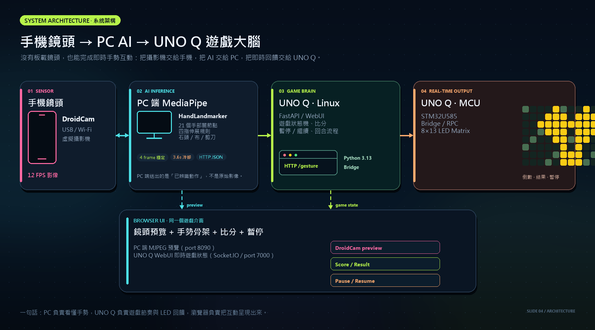
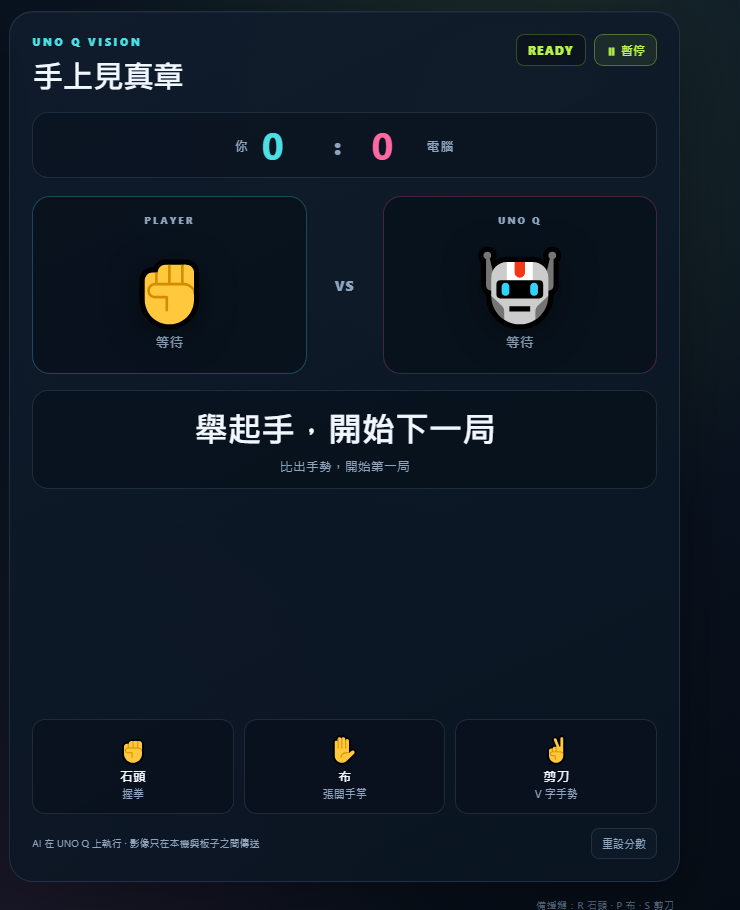

# UNO Q Gesture RPS

An AI rock-paper-scissors game built around **Arduino UNO Q**, a browser UI, and a PC-side **MediaPipe** gesture classifier.

The phone camera (DroidCam) or a regular USB webcam is captured on the PC. MediaPipe extracts 21 hand landmarks, classifies the hand as rock, paper, or scissors, and sends the result to the UNO Q game API. The UNO Q Linux side owns the game state and score; the STM32 MCU drives the 8x13 LED matrix through the Arduino Router Bridge.





## Features

- Real-time rock / paper / scissors recognition from hand landmarks
- Stable-gesture filtering: 4 consecutive frames
- 3.6 s cooldown and hand-release re-arming
- HTTP `POST /gesture` from the PC to UNO Q
- UNO Q Linux game state, scoring, pause/resume, and WebUI
- STM32U585 LED matrix output through Bridge/RPC
- Browser UI with live preview, score, round, and pause button
- Optional regular webcam support (no DroidCam required)

## Architecture

```text
Phone DroidCam / USB webcam
        │
        ▼
PC: OpenCV capture ──► MediaPipe HandLandmarker
        │                       │
        │                       ▼
        │              finger-extension rules
        │                       │
        │              HTTP POST /gesture
        │                       ▼
        │              UNO Q Linux (WebUI + game state)
        │                       │
        │                Bridge / RPC
        │                       ▼
        └────────────► STM32U585 ──► 8x13 LED matrix
```

The browser reads the MJPEG preview from the PC (`:8090/video`) and receives game state from the UNO Q WebUI (`:7000`) over Socket.IO.

## Repository layout

```text
arduino_app/                  Arduino App Lab project
  app.yaml
  python/main.py              game state, WebUI, /gesture API, pause
  assets/                     HTML/CSS/JS UI
  sketch/sketch.ino           LED matrix driver + Bridge.provide("draw")
pc_bridge/
  pc_mediapipe_gesture.py     camera + MediaPipe + preview server
  hand_landmarker.task        MediaPipe Hand Landmarker model
docs/
  architecture.png
  ui_scoreboard.png
requirements.txt
```

## Requirements

### Board

- Arduino UNO Q
- Arduino App Lab / `arduino-app-cli`
- USB connection to the PC

### PC

- Python 3.10+
- Phone with DroidCam, or a regular USB / built-in webcam
- Packages in `requirements.txt`

```bash
python -m pip install -r requirements.txt
```

## Run

### 1. Deploy the board app

Copy `arduino_app/` to the board as `/home/arduino/ArduinoApps/unoq_gesture_rps`, then:

```bash
arduino-app-cli app start /home/arduino/ArduinoApps/unoq_gesture_rps
```

Forward the WebUI port over USB:

```bash
adb -s <BOARD_SERIAL> forward tcp:17000 tcp:7000
```

### 2. Start the PC bridge

```bash
cd pc_bridge
python pc_mediapipe_gesture.py
```

The bridge exposes a preview stream at:

```text
http://127.0.0.1:8090/video
```

### 3. Open the game

```text
http://127.0.0.1:17000/?externalCamera=1&previewUrl=http://127.0.0.1:8090/video
```

No browser camera permission is needed in this mode: the browser displays the PC preview, while gesture classification happens in the PC bridge.

## Camera selection

By default the bridge looks at camera index `1`, then scans indices `0–5` and chooses the stream with the highest frame variance. Override it with:

```powershell
$env:CAMERA_INDEX=0
python pc_mediapipe_gesture.py
```

Use a regular webcam by closing DroidCam first and setting `CAMERA_INDEX` to the webcam index.

## Gesture rules

| Extended fingers | Gesture |
|---|---|
| 0 | Rock |
| Index + middle | Scissors |
| 4 | Paper |

A prediction is accepted only after 4 identical frames. After sending a move, the bridge waits 3.6 seconds and re-arms after the hand leaves the frame.

## Pause behavior

`Pause` cancels the current countdown/round and rejects new gestures with:

```json
{"ok": false, "reason": "paused"}
```

`Resume` returns the game to `READY`; a new stable gesture starts the next round.

## Test log

```text
stable gesture: rock      -> {"ok":true,"move":"rock"}
stable gesture: paper     -> {"ok":true,"move":"paper"}
stable gesture: scissors  -> {"ok":true,"move":"scissors"}
game paused -> {"ok":false,"reason":"paused"} -> game resumed
```

## Notes

- The deployed UNO Q app keeps the earlier `video_object_detection` brick and camera-server code as a legacy path. The current gameplay path uses the PC-side MediaPipe classifier through `POST /gesture`; no board camera is required.
- The model file is included at `pc_bridge/hand_landmarker.task` for convenience.
- The browser page is intentionally served over HTTP through an ADB-forwarded localhost port. Camera access is handled by the PC bridge, not by the browser.
